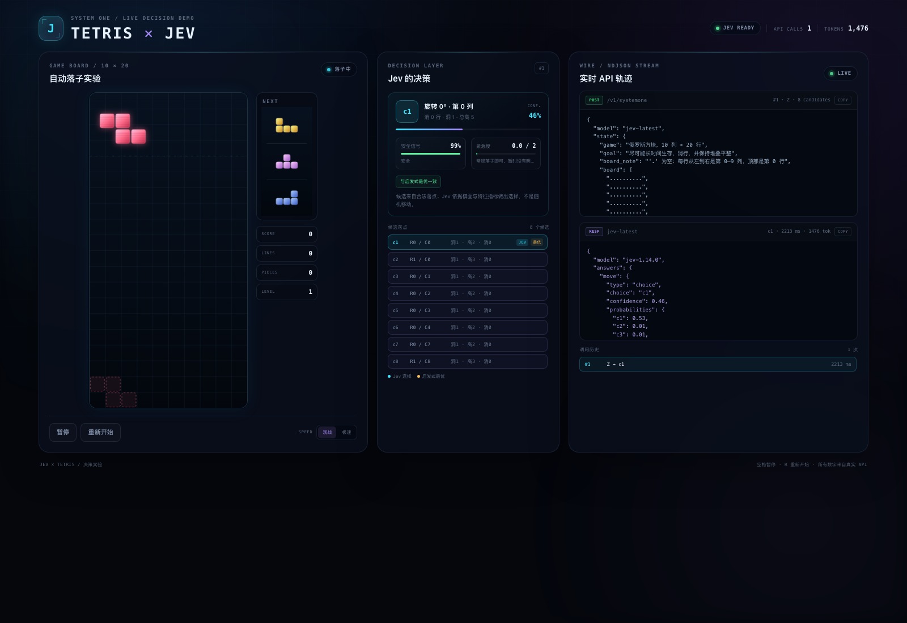

# Jev Demo

本仓库包含两个可交互的 Jev Demo——“睡眠手环排障台”和“Jev 玩俄罗斯方块”，以及 Jev / TypeSafe 的学习资料和 API 示例。

| Demo | 内容 | 端口 |
|---|---|---|
| [睡眠手环排障台](support-demo/README.md) | 六轮对话收集证据，定位手环无数据问题的主因并路由处理方 | 8787 |
| [JEV × TETRIS](tetris-demo/README.md) | Jev 从合法落点中逐步选择，实时展示请求参数和原始响应 | 8788 |

两个 Demo 相互独立，可以同时启动。

## 睡眠手环排障台（推荐演示）

用户购买睡眠手环，佩戴一晚后，第二天 App 里没有睡眠数据。页面通过六轮对话收集证据，每一步真实调用一次 Jev，最后一轮结合全部证据判断主因，并路由到：

- 用户侧：佩戴方式、电量
- 客服侧：蓝牙同步、App 权限 / 账号、数据不足、人工复核
- 研发 / 质量侧：硬件或固件故障

完整说明见 **[support-demo/README.md](support-demo/README.md)**。

### 另一台电脑快速启动

前置条件：Python 3.8+、可用的 `TYPESAFE_API_KEY`、能访问 `https://api.jevgo.cn`。

```bash
git clone https://github.com/monkey-jz/jev_demo.git
cd jev_demo

# 每台机器单独创建一份，放在仓库根目录；.env 不会从 GitHub 拉取
cp support-demo/env.example .env
# 编辑根目录 .env，填写 TYPESAFE_API_KEY（两个 demo 和 examples/ 共用这一份）

bash support-demo/start.sh
```

打开 <http://127.0.0.1:8787>。健康检查：

```bash
curl -s http://127.0.0.1:8787/api/health | python3 -m json.tool
```

- 不要直接双击 `support-demo/index.html`，必须通过本地服务打开。
- 8787 被占用时：`PORT=9000 bash support-demo/start.sh`。
- 网络需要代理时，在 `.env` 里设置 `TYPESAFE_PROXY=http://127.0.0.1:7890`（替换成实际地址）。
- Windows 请用 PowerShell 运行 `python support-demo\server.py`，并先创建仓库根目录的 `.env`。
- `git clone` 超时通常是 GitHub 网络问题，与 Demo 的 Jev 代理是两回事，详见 `support-demo/README.md`。

## JEV × TETRIS：让 Jev 玩俄罗斯方块



浏览器端的规则引擎先枚举当前方块的所有合法落点，筛出最多 8 个有差异的候选；本地服务把棋盘和候选组装成 Jev 的 `choice` 问题，同时附带 `noul` 安全问题和 `score` 紧急度问题。等待 Jev 返回时方块缓慢自然下落；若响应先到，方块转向选中的落点；若方块先接触堆叠，则按自然落点锁定，迟到的选择不再移动它。

右侧控制台会**在 Jev 返回之前**先展示这次请求的完整参数；收到结果后再展示原始响应、置信度、probabilities 和 token 用量，适合现场演示“模型收到了什么、回了什么”。

完整说明见 **[tetris-demo/README.md](tetris-demo/README.md)**。

### 另一台电脑快速启动

前置条件与上面相同。在仓库根目录：

```bash
cp support-demo/env.example .env
# 同样放在仓库根目录，与排障台共用同一份 key

bash tetris-demo/start.sh
```

打开 <http://127.0.0.1:8788>。健康检查：

```bash
curl -s http://127.0.0.1:8788/api/health | python3 -m json.tool
```

- 8788 被占用时：`PORT=9000 bash tetris-demo/start.sh`。
- 代理、Windows、`.env` 的规则与排障台一致，详见 `tetris-demo/README.md`。
- 快捷键：`空格` 暂停 / 继续，`R` 重新开始。

> **API 消耗提醒：** Tetris 每落一块就是一次真实的 Jev 调用，观战模式下约 1.4k–1.5k input tokens / 次。页面里有累计调用和 token 统计，演示完请暂停，不要让它持续整晚运行。

## 其他内容

| 路径 | 内容 |
|---|---|
| `support-demo/` | 睡眠手环交互式排障台（HTML + Python 本地代理） |
| `tetris-demo/` | Jev 决策式俄罗斯方块，实时请求 / 响应控制台 |
| `jev-internal-share.md` | Jev 概念、环境配置、使用方式和示例的内部分享 |
| `jev-demo-all.sh` | 批量运行 API 示例的脚本 |
| `examples/01`–`09` | 每个示例的独立脚本 |

## 安全提醒

按之前的要求，`jev-internal-share.md` 保留了历史演示 Key。这个仓库是公开的，任何提交进仓库的 Key 都应视为已暴露；换机器演示时建议使用单独或可轮换的 Key，并确保 `support-demo/.env` 和 `tetris-demo/.env` 不被提交（两个 `.env` 都已被 `.gitignore` 忽略）。
