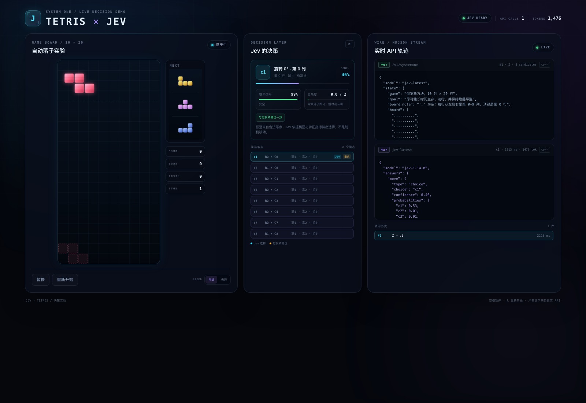

# JEV × TETRIS · 决策式俄罗斯方块

让 Jev 真正“玩”俄罗斯方块：浏览器负责枚举合法落点，服务端把 ASCII 棋盘和最多 8 个候选落点组装成 Jev 的 `choice` 问题；Jev 每选一步，页面就落下一块。

页面右侧会**实时显示这次请求的完整参数**和 **Jev 的原始响应**。请求参数会在 Jev 返回之前先到达浏览器，方便在演示时指着屏幕讲解“模型收到了什么、回了什么”。等待响应时方块会沿当前列缓慢下落；Jev 返回后转向选中的落点。如果方块已经接触堆叠，则按自然落点锁定，迟到的 Jev 选择只展示、不再移动它。



## 换一台电脑：最短启动路径

### 0. 前置条件

- Python **3.8+**（推荐 3.9+）
- 能访问 `https://api.jevgo.cn` 的网络（如无直连，可走代理；也可用 `JEV_API_URL` 改回官方 `https://api.typesafe.ai/v1/systemone`）
- 一个可用的 `TYPESAFE_API_KEY`
- macOS / Linux 可直接用 `start.sh`；Windows 用 PowerShell 手动启动，或 Git Bash / WSL

### 1. 拉取仓库

```bash
git clone https://github.com/monkey-jz/jev_demo.git
cd jev_demo
```

如果 `git clone` 超时或被重置，说明这台电脑拉 GitHub 需要代理。把地址换成实际代理：

```bash
git -c http.proxy=http://127.0.0.1:7890 -c http.version=HTTP/1.1 \
  clone https://github.com/monkey-jz/jev_demo.git
```

Git 的代理只影响拉代码；Demo 访问 Jev 的代理在下一步用 `.env` 单独控制。

### 2. 配置 API Key

```bash
cp tetris-demo/env.example .env
# 编辑仓库根目录的 .env，填写 TYPESAFE_API_KEY
# 这一份 .env 同时被 support-demo 和 examples/ 共用
```

`.env` 已被 `.gitignore` 忽略，不会从 GitHub 拉取，也不会被提交——每台机器都要单独创建。也可以直接：

```bash
export TYPESAFE_API_KEY="apikey_..."
```

`start.sh` 的 Key 读取顺序：

1. 已导出的 `TYPESAFE_API_KEY`
2. `~/.bash_profile` / `~/.profile` / `~/.bashrc` 中第一个能设置它的文件
3. 交互式提示输入（不回显、不落盘）
4. 仓库根目录的 `.env`（由 `server.py` 自己加载）

### 3. 启动

```bash
bash tetris-demo/start.sh
```

打开：

```text
http://127.0.0.1:8788
```

不要直接双击 `tetris-demo/index.html`。`file://` 页面无法请求本地的 `/api/decide`，也拿不到服务端的 Key 代理。

健康检查：

```bash
curl -s http://127.0.0.1:8788/api/health | python3 -m json.tool
```

`/api/health` 只返回配置状态（模型、Key 是否配置、是否加载 `.env`、是否使用代理），不会返回 Key 本身。

### 4. 端口或代理有问题时

```bash
# 8788 被占用
PORT=9000 bash tetris-demo/start.sh

# 强制直连
TYPESAFE_PROXY="" bash tetris-demo/start.sh

# 指定代理
TYPESAFE_PROXY="http://127.0.0.1:7890" bash tetris-demo/start.sh
```

代理探测顺序：

1. `TYPESAFE_PROXY`（显式设置优先，空值 = 直连）
2. `HTTPS_PROXY` / `https_proxy` / `HTTP_PROXY` / `http_proxy`
3. 本机 `127.0.0.1:7890`（ClashX 常见端口）
4. 直连

如果 API 返回 **HTTP 451**、连接超时或 `network error`，通常是当前网络无法直连：

```dotenv
TYPESAFE_PROXY=http://127.0.0.1:7890
```

### Windows PowerShell

```powershell
git clone https://github.com/monkey-jz/jev_demo.git
cd jev_demo
Copy-Item tetris-demo\env.example .env
# 编辑仓库根目录的 .env，填写 TYPESAFE_API_KEY
python tetris-demo\server.py
```

如果系统里是 `py` 而不是 `python`：

```powershell
py -3 tetris-demo\server.py
```

## 演示时怎么讲

1. 点击「开始一局」。
2. 左侧棋盘出现当前方块和半透明落点预览；中间显示规则引擎筛出的 8 个合法候选。
3. 右侧 `POST /v1/systemone` 的完整请求会先出现，状态变成 **STREAMING**。此时方块仍在沿当前列缓慢下落，Jev 同时推理。如果方块先接触堆叠，状态会变成「已自然落地 · 等待 Jev」，它的位置从此固定。
4. Jev 返回后：
   - 中间显示选中的候选、置信度、安全信号和紧急度；
   - 右侧显示 Jev 原始响应和 token 用量；
   - 左侧从方块当前的位置转向 Jev 选中的落点，然后进入下一块；
   - 若方块已经自然落地，则不移动它，直接按自然落点锁定，并在决策区标注「本次选择未应用」。
5. 可随时暂停、继续、切换「观战 / 极速」或重新开始。

快捷键：`空格` 暂停 / 继续，`R` 重新开始。

> 每落一块就是一次真实的 Jev 调用，会消耗真实 token。观战模式下大约 1.4k–1.5k input tokens / 次，深色控制台里有累计调用和 token。演示时建议手动暂停，不要让它整晚跑。

## 现场演示前检查

- **先跑 2–3 步真实请求**：`/api/health` 只能确认 Key 和代理已配置，不能证明 Key 有效、网络可达或延迟正常。
- **关注响应延迟**：方块从顶部落到空棋盘底部约 5.8 秒。如果 Jev 经常晚于这个时间返回，方块会先自然落地，迟到的选择会在界面和调用历史里标为「未应用」。这是设计行为，不是故障。网络较慢时优先换网络或代理；也可以调大 `game.js` 里的 `WAIT_FALL_MS_PER_ROW`。
- **确认 Key 来源**：`start.sh` 会优先使用已导出的 `TYPESAFE_API_KEY` 和 shell profile 里的值，最后才轮到 `.env`。如果出现 401，先检查当前 shell 或 profile 里是否有旧 Key。
- **Token 预算**：每块一次真实调用；演示结束按暂停，不要让页面持续跑。
- **打开方式**：使用完整地址 `http://127.0.0.1:8788`，不要用 `file://` 直接打开 HTML。
- **窗口与投影**：建议 1280×800 以上；正式演示前按现场投影分辨率试一次。
- **兜底素材**：网络完全不可用时，用 `screenshot.png` 或提前录屏讲解。

## 一次决策里发生了什么

### 1. 浏览器：规则引擎先枚举

`engine.js` 负责纯规则，不含 API 调用：

- 10 列 × 20 行棋盘，7-bag 随机；
- 生成每个方块的所有旋转；
- 对每种旋转枚举所有落点，硬降落到底；
- 过滤非法落点，计算消行、洞、总高度、最高列、凹凸度、井、落地高度；
- 用本地启发式排序，并构造一份**有差异的短名单**：全局最优、每种旋转的最优、一个能消行的落点，再补齐到最多 8 个。

短名单不是让模型“自由发挥”。Jev 只能从这些合法落点里选一个；最终落子仍由浏览器执行。

### 2. 浏览器 → 本地服务

浏览器只发送紧凑的游戏状态，不发送 API Key：

```json
{
  "seq": 1,
  "board": ["..........", "..........", "..."],
  "active": "Z",
  "next": ["O", "T", "L"],
  "stats": { "score": 0, "lines": 0, "pieces": 0 },
  "candidates": [
    {
      "rotation": 0,
      "column": 0,
      "row": 18,
      "lines_cleared": 0,
      "holes": 1,
      "holes_added": 1,
      "aggregate_height": 5,
      "max_height": 2,
      "bumpiness": 2,
      "wells": 0,
      "landing_height": 0,
      "heuristic": -2.42
    }
  ]
}
```

### 3. 本地服务 → Jev

`server.py` 校验棋盘和候选字段，组装成一个 `state` 加三个问题：

```json
{
  "model": "jev-latest",
  "state": {
    "game": "俄罗斯方块，10 列 × 20 行",
    "goal": "尽可能长时间生存、消行，并保持堆叠平整",
    "board": ["..."],
    "active_piece": "Z",
    "next_pieces": ["O", "T", "L"],
    "stats": { "score": 0, "lines": 0, "pieces": 0 },
    "turn": 1
  },
  "questions": {
    "move": {
      "type": "choice",
      "instructions": "根据棋盘和候选落点，选择最有利于继续生存、消行和保持平整的一步……",
      "criteria": {
        "c1": "c1：旋转 0°，落到第 0 列；本次消 0 行，落子后洞 1 个……"
      }
    },
    "safe": {
      "type": "noul",
      "instructions": "当前棋盘是否仍然安全，没有进入随时可能封顶的危险区？"
    },
    "urgency": {
      "type": "score",
      "instructions": "当前这一步对消行或降低堆叠的紧急程度如何？",
      "criteria": ["常规落子", "需要主动管理", "接近封顶"]
    }
  }
}
```

- `move`（`choice`）：选择 `c1`–`c8` 中一个合法落点；
- `safe`（`noul`）：当前棋盘是否安全，页面显示为 0–100%；
- `urgency`（`score`）：0–2 的紧急度，页面显示为进度条。

服务端再次检查 Jev 返回的 `choice` 是否在候选里；如果模型返回了候选之外的键，会降级到启发式最优，并在页面标注 `fallback_reason`。

### 4. 实时流：请求先到，响应后到

`/api/decide` 返回的不是一个等待 3 秒的普通 JSON，而是 `application/x-ndjson` 的 chunked 流：

```text
{"type":"request","seq":1,"payload":{完整的 Jev 请求参数}}
{"type":"result","seq":1,"data":{选择、置信度、概率、原始响应、token}}
```

浏览器用 `ReadableStream` 边读边渲染。因此演示时可以先看到**完整请求参数**，再看到 Jev 的推理结果，而不是等所有事情结束后一起出现。

等待期间方块会沿当前列缓慢持续下落，但这是**纯视觉层**：

- 发送给 Jev 的棋盘快照、候选坐标和候选指标在请求发出后不再变化；
- 正在下落的方块不属于已锁定棋盘，不会改变消行、洞或高度；
- 如果响应先到，方块从当前动画位置转向选中的候选，因此响应仍然对应同一个棋面和同一组合法落点；
- 如果方块先接触堆叠，就标记为「已自然落地」。Jev 返回后只展示这次选择，不再移动方块，而是按自然落点提交；请求失败时也一样。

### 5. 结果回到棋盘

浏览器按 `candidate_index` 找到本地候选，播放落子动画；若有消行，先闪一下整行，再把消行后的棋盘作为下一回合的初始状态。

如果这一回合的 API 失败（网络、超时、错误响应），页面会：

- 在响应区显示错误；
- 把调用历史标成红色；
- 方块尚未落地时，用本地启发式最优落点继续落子；
- 方块已经自然落地时，保持自然落点，不再移动；
- 在决策区标注对应的兜底方式。


## 文件和职责

```text
tetris-demo/
├── screenshot.png  # 界面截图
├── start.sh        # 读取 Key / 启动服务
├── env.example     # 复制为仓库根目录的 .env 后填写 Key；.env 不会提交
├── index.html      # 棋盘、决策面板、实时请求/响应控制台
├── style.css       # 深色界面和响应式布局
├── engine.js       # 纯规则：旋转、合法落点、消行、启发式、候选短名单
├── game.js         # 游戏循环、Canvas 渲染、NDJSON 读取、错误兜底
├── server.py       # 静态页 + Jev 代理 + 参数校验 + 请求/响应流
└── README.md
```

API Key 只存在于服务端环境变量 / `.env` 中，浏览器 JS 和浏览器网络请求里都没有。

## 环境变量

| 变量 | 默认值 | 说明 |
|---|---|---|
| `TYPESAFE_API_KEY` | 无 | 必填，只在服务端使用 |
| `TYPESAFE_PROXY` | 自动探测 | 显式代理地址；设为空字符串表示强制直连 |
| `HTTPS_PROXY` / `https_proxy` | 自动继承 | 标准代理环境变量；没有显式 `TYPESAFE_PROXY` 时使用 |
| `PORT` | `8788` | 本地服务端口 |
| `HOST` | `127.0.0.1` | 监听地址；默认只允许本机访问 |

## 常见问题

| 现象 | 处理 |
|---|---|
| `Address already in use` / 端口被占用 | 停掉旧实例，或 `PORT=9000 bash tetris-demo/start.sh` |
| `TYPESAFE_API_KEY 未设置` | 检查仓库根目录的 `.env` 是否填了 key，或 `export TYPESAFE_API_KEY=...` |
| HTTP 401 / 403 | Key 错误、失效，或账号没有该模型权限 |
| HTTP 451 / 超时 / network error | 设置 `TYPESAFE_PROXY`；确认代理程序已启动 |
| 页面打开但开始后一直不动 | 打开浏览器控制台和 `/api/decide` 响应区；确认 `server.py` 仍在运行 |
| `python3: command not found` | 安装 Python 3.8+，或改用 `python` / `py -3` |
| 局域网访问 | 默认 `HOST=127.0.0.1` 只允许本机；改成 `0.0.0.0` 会把这个无认证 Demo 暴露给同网段，仅在可信网络使用 |

> 如果使用 Docker、远程开发机或虚拟机：默认 `127.0.0.1` 只在容器 / 虚拟机内部可见，需要在宿主机做端口转发。

## 这个 Demo 的边界

这是用于观察 Jev「选择式决策」的交互实验，不是完整的俄罗斯方块或生产游戏：

- 候选合法性由浏览器端的规则引擎负责；服务端校验字段和棋盘形状，但不会重新枚举所有落点；
- 没有登录、限流、审计、并发控制；
- 每个方块一次 API，没有请求重试和 token 预算控制；
- 生产环境应改为独立服务、密钥托管、输入输出审计，并考虑把棋盘快照和决策日志落库；
- 不要把本地代理和 `.env` 方案直接搬到生产网络。

## 为什么不是纯前端 HTML

纯前端直接调用 `api.jevgo.cn` 会让 API Key 进入浏览器 JS，等于公开；同时还要处理 CORS、代理和密钥轮换。

这里的链路是：

```text
浏览器 index.html + engine.js + game.js
      │  POST /api/decide（不含 Key）
      ▼
tetris-demo/server.py
      │  Authorization: Bearer $TYPESAFE_API_KEY
      ▼
https://api.jevgo.cn/v1/systemone
```

浏览器只接触本地服务的 `/api/decide` 和 `/api/health`。
